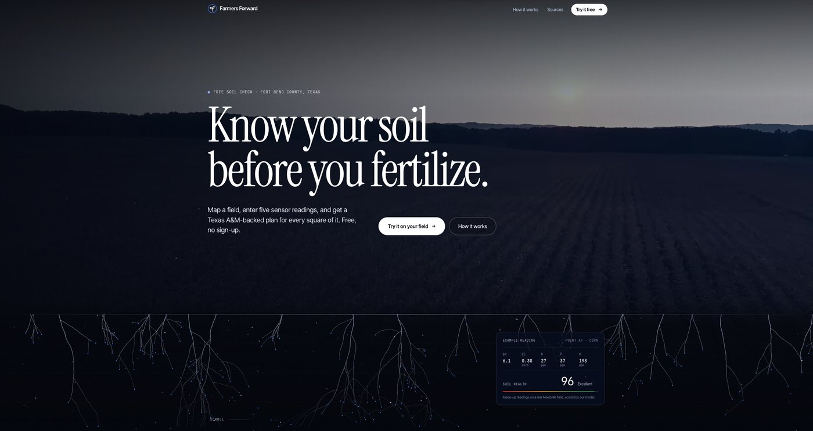

## Farmers Forward: Soil Data for Small Farms

**Project description:** Farmers Forward is a free soil-check app for small farms in Fort Bend County, Texas. A farmer maps a field, enters five sensor readings, and gets a fertilizer plan for every part of it, backed by Texas A&M guidance. No cost and no sign-up. I co-founded it with friends, and we entered it in the Congressional App Challenge.

**My role:** I built the model that turns raw soil readings into guidance farmers can actually act on.

**[Try it live](https://farmersforward-r4ty.onrender.com/)**

### How it works

- **Map your field.** Search for your farm and drop sample pins where you tested, then drag them to adjust.
- **Enter five readings per sample:** pH, EC (electrical conductivity), nitrogen, phosphorus, and potassium, plus the crop you're growing there.
- **Get a soil health score and a plan.** The model scores each sample point and turns the numbers into fertilizer recommendations tuned to that crop, so farmers only add what each part of the field needs.

### Why it matters

Small farms often fertilize the whole field the same way because lab soil analysis is expensive and hard to read. Cheap sensor readings plus a clear plan means less wasted fertilizer, lower costs, and less runoff.

### Tech Stack

React frontend with an interactive Leaflet field map, a custom soil scoring model, and nutrient guidance drawn from Texas A&M sources. Hosted on Render.

[← Back to Portfolio](/)
