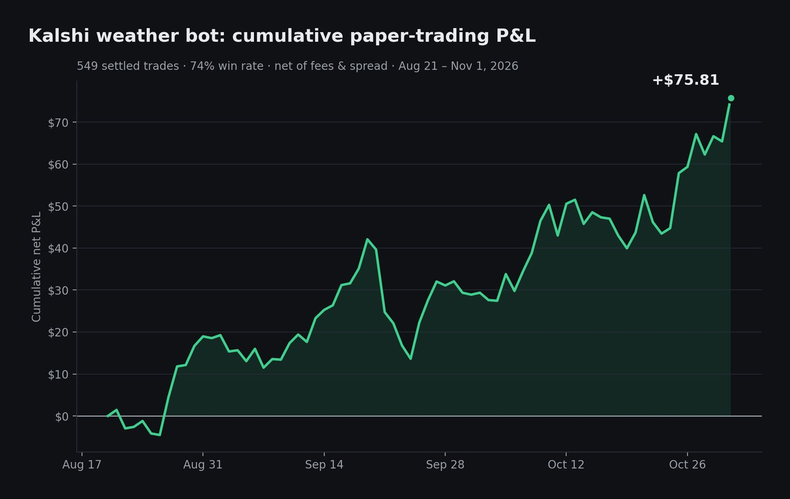
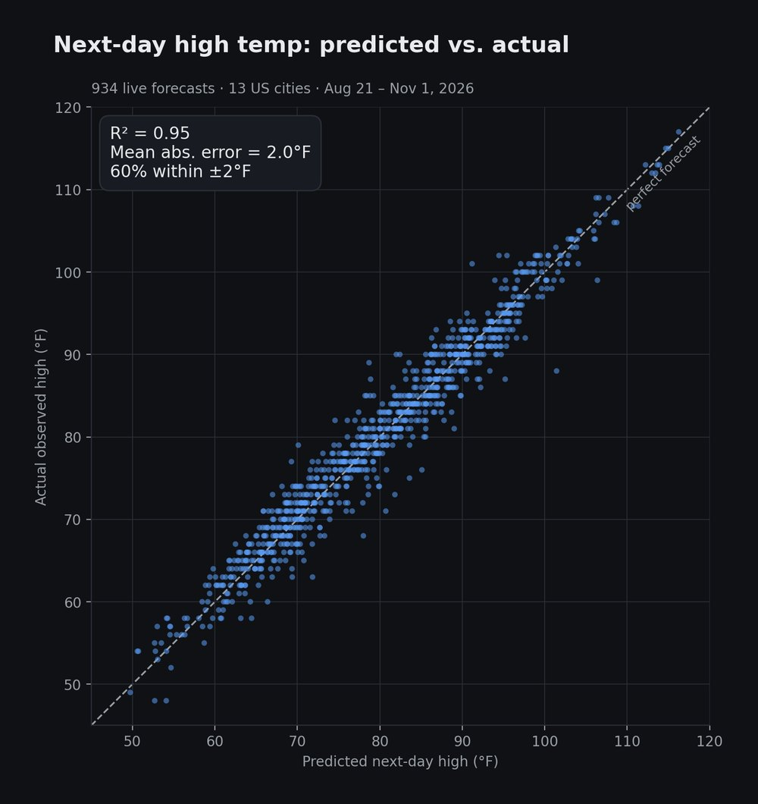
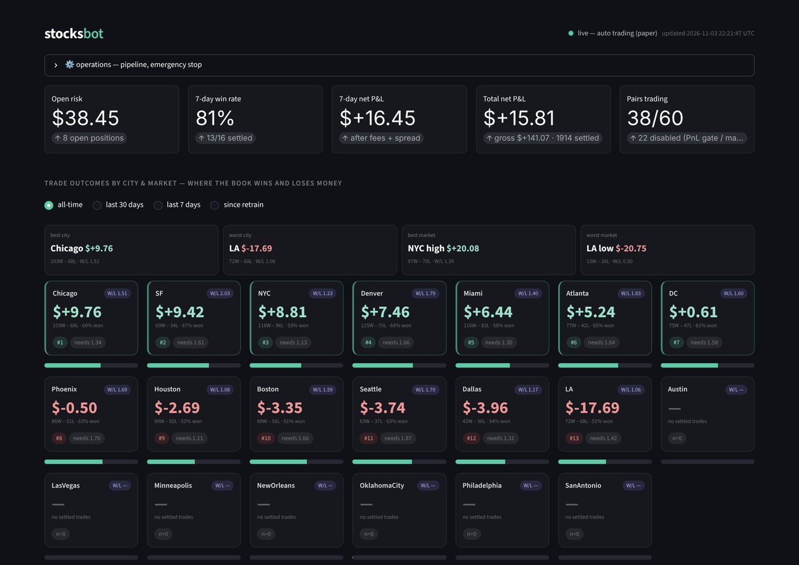

## StockSpot

**Project description:** StockSpot is a solo-built algorithmic trading system that has evolved since mid-2025 from a basic trading dashboard into a multi-signal machine learning pipeline. Its live engine forecasts next-day high temperatures across 13 US cities and paper-trades Kalshi weather markets automatically, net of fees and spread. Next up: crypto, sports arbitrage, and shipping signals.

### Live Paper-Trading Results

549 settled trades from Aug 21 to Nov 1, 2026, with a 74% win rate and +$75.81 net of fees and spread. All trades are paper trades.

### Forecast Accuracy

Across 934 live forecasts in 13 cities, the model's next-day highs hit R² = 0.95 against observed temperatures, with a mean absolute error of 2.0°F.

### Monitoring Dashboard

A live dashboard on the server tracks open risk, win rate, and P&L by city and market, with an emergency stop. Losing city/market pairs are disabled automatically by a P&L gate.

### Strategies

- **S1 Tomorrow Temperature:** forecasts the next-day high and trades Kalshi temperature brackets (the live engine above)
- **S3 Three-Day Trend:** multi-day temperature trend signal, R² = 0.137 in backtest

### Tech Stack

Python, XGBoost, LightGBM, and scikit-learn, pulling data from Open-Meteo and the Kalshi API, running 24/7 on a DigitalOcean server with scheduled jobs and a Streamlit dashboard.

### Roadmap

Seven additional signals (NWS station bias, model-ensemble spread, coastal marine layer, snowfall, hurricane track uncertainty, and more), then portfolio optimization via Kelly/Markowitz sizing, followed by crypto, sports arbitrage, and shipping-index signals.

For more, [view my GitHub profile](https://github.com/atatti-240).

[← Back to Portfolio](/)
